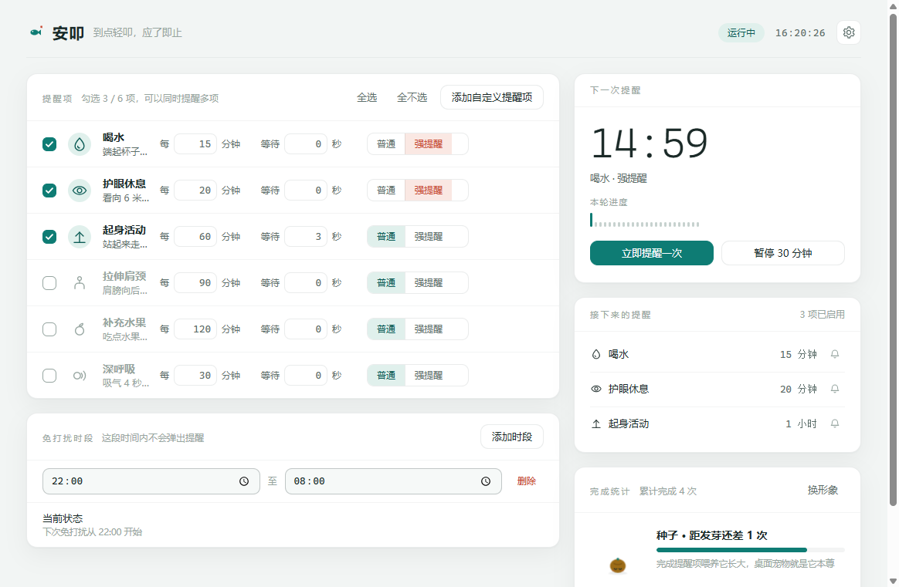
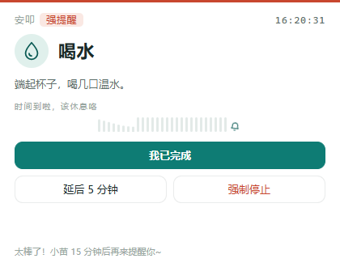
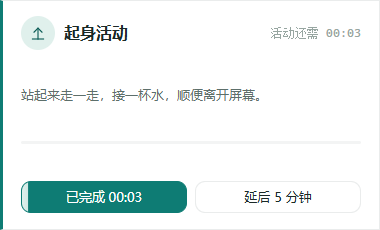
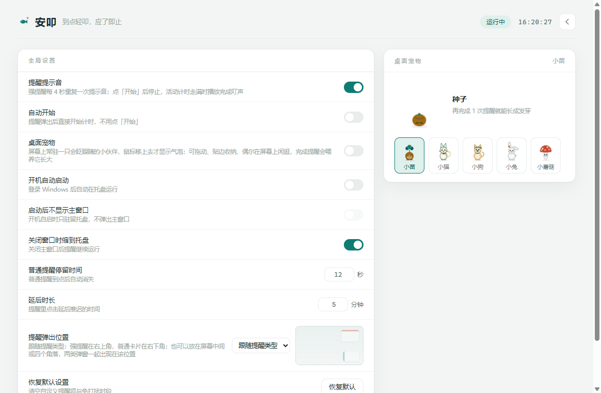
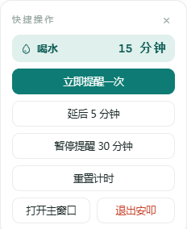

# 安叩 Anko

到点轻叩，应了即止。按间隔提醒喝水、护眼、起身活动的桌面常驻程序。

- **Windows 版**（本仓库当前内容）：Electron 打包，安装包与绿色版都自带运行时，目标电脑不需要安装 Python、.NET、Node 或任何运行库。
- **Android 版**：渲染层与业务规则是纯 Web 代码与平台无关的 TypeScript，后续用 Capacitor 套壳即可复用，接口预留见文末。

## 功能

| 功能 | 说明 |
| --- | --- |
| 预设提醒项 | 喝水、护眼休息、起身活动、拉伸肩颈、补充水果、深呼吸，各自带默认等待时间：喝水 5 秒、护眼 20 秒、起身 60 秒、拉伸 60 秒、水果 5 秒、呼吸 5 秒 |
| 多选提醒项 | 复选框勾选多个项目同时提醒，勾选结果立即生效并保存 |
| 自定义提醒项 | 自建名称、文案、间隔、所需时长与强度，可随时修改或删除 |
| 所需时长 | 每个提醒项可设置完成活动需要的秒数（0 表示不限时）；提醒弹出后点「开始」才计时，计时走满「我已完成」才可点击；强提醒点「开始」后停止循环提示音，走满时播放一次完成叮声；普通卡片在活动计时走满前保持展示，走满后留 3 秒宽限再自动消失；旧版本升级上来时按上表的预设等待时间自动补齐 |
| 完成统计 | 主窗口展示累计完成次数与各提醒项的完成次数；完成提醒喂养桌面宠物，按五个成长阶段长大，每个形象有自己的阶段叫法（小苗是种子到大树，小猫是猫崽到猫大王）；卡片里的「换形象」直达设置页的宠物形象选择 |
| 免打扰时段 | 可设置多组时间段，跨零点自动识别；时段内到期的提醒顺延到时段结束后，不会集中弹出；卡片在主页提醒项下方，直接增删时段 |
| 强提醒 | 置顶的白色小窗，需要点「我已完成」或「延后 N 分钟」才会消失，无法用关闭按钮或 Alt+F4 关掉 |
| 强制停止 | 弹窗里的「强制停止」需要二次确认，倒计时结束后才能真正中断 |
| 提醒弹出位置 | 默认跟随提醒类型：强提醒在右上角，普通卡片在右下角；也可以固定到屏幕中间或左上、右上、左下、右下任意角落，两类弹窗一起出现在该位置；弹窗标题区可以按住拖动，拖到哪就停在哪，位置一直记住，设置里点「归位」恢复默认 |
| 自动开始 | 打开后提醒弹出就直接开始计时，不用再点「开始」 |
| 设置入口 | 主窗口右上角的设置图标打开设置页，里面是全局设置与桌面宠物形象，再点一次图标回到主页 |
| 屏幕锁定暂停 | 检测到屏幕锁定或休眠时暂停调度并收掉正在展示的提醒（不记完成），解锁后全部提醒项从解锁时刻重新计一个完整间隔，不会集中补弹 |
| 全屏避让 | 鼠标所在屏幕出现全屏应用（游戏、视频、幻灯片放映）时，调度暂停、该屏上的提醒窗口与桌面宠物自动收起，离开全屏后恢复；托盘悬停提示「全屏应用中，提醒暂缓」 |
| 多屏定位 | 强提醒与普通卡片都落在鼠标所在的显示器，桌面宠物初始位置与贴边收纳也按所在显示器计算，多屏时提醒不出现在用户看不到的屏幕上 |
| 高 DPI | 125% / 150% 系统缩放下文字与图形保持清晰、窗口不错位 |
| 立即提醒一次 | 主窗口卡片、桌面宠物快捷面板、托盘、`Ctrl+Alt+R` 都预览「下一次提醒」卡片展示的那一项（到期最早的一项）；「接下来的提醒」列表每行有「立即提醒一次」按钮，预览指定的那一项；弹窗里点「我已完成」按本轮已完成处理，间隔从当前时间重新起算 |
| 桌面宠物 | 可开关的置顶小窗，窗里是一只会眨眼睛的小伙伴，有呼吸、眨眼、原地小跳、走动闲逛等动作；每种形象有自己的招牌动作：小猫甩尾巴、小狗摇尾巴、小兔耳朵一颠一颠、小蘑菇伞盖摇摆、小苗叶子轻摆；可拖动、拎起；平时不显示气泡，鼠标移上去才出现状态与倒计时，移上去时身体前倾、动作加快；拖到屏幕左右边缘自动贴边收起，边缘留着半张脸，鼠标碰到露出的半张脸才展开，鼠标离开再收起，贴边期间不闲逛；位置自动记住；提醒进行中弹跳催促，招牌动作同步加快，喝水类提醒做饮水姿态、闭眼休息类做深呼吸姿态，屏幕锁定时睡觉，完成提醒时跳一下庆祝并冒出爱心；跨过成长阶段时播放升阶演出，闪白换成新阶段的形象，光环与碎星炸开，头顶弹出新阶段名 |
| 宠物形象 | 小苗、小猫、小狗、小兔、小蘑菇五种形象可选，每种形象的五个成长阶段各有不同长相：小苗从种子长出大树，小猫从猫崽长出虎斑、铃铛铜钱到戴冠的猫大王，小狗耳朵从垂到立、扎上头巾再佩铜牌，小兔耳朵越长越长、垂耳兔别上一朵小花、玉兔浮起光晕，小蘑菇从孢子长到脚边带着小蘑菇的巨型蘑菇；设置页里有预览，选定的形象同时用在桌面宠物与主窗口的成长进度上 |
| 快捷面板 | 单击桌面宠物在宠物旁弹出小面板：立即提醒一次、延后 N 分钟、暂停提醒 30 分钟、重置计时、打开主窗口、退出安叩；双击打开主窗口，右键出快捷菜单（含重置计时），悬停显示下次提醒详情 |
| 全局快捷键 | 任意界面下按 `Ctrl+Alt+R` 立即弹一次提醒，主窗口收在托盘时也有效 |
| 图标随提醒变化 | 铃铛与涟漪图案，浅薄荷底色；托盘与窗口图标随下次提醒的接近程度从方正逐渐变圆，提醒正在进行时是正圆；托盘悬停提示显示下次提醒时间 |
| 常驻托盘 | 关闭主窗口后继续在托盘运行，托盘菜单可以暂停 30 分钟、恢复、立刻提醒一次、退出 |
| 其他 | 提示音、开机自启、启动后不显示主窗口、普通提醒自动消失时间、延后时长均可配置 |

## 界面

| 主窗口 | 强提醒 |
| --- | --- |
|  |  |

| 普通提醒卡片 | 桌面宠物升阶 |
| --- | --- |
|  |  |

| 设置页 | 快捷面板 |
| --- | --- |
|  |  |

## Windows 使用

发布目录 `release` 下有三个产物：

| 文件 | 用途 |
| --- | --- |
| `安叩-1.0.0-安装包.exe` | NSIS 安装包，可选安装目录，创建桌面与开始菜单快捷方式 |
| `安叩-1.0.0-单文件绿色版.exe` | 单文件绿色版，双击即用，不写注册表，运行时在临时目录解包 |
| `安叩-1.0.0-绿色版.zip` | 免安装目录版，解压后运行 `ankou.exe`，适合放在 U 盘或受限电脑 |

依赖情况：绿色版包含完整的 Chromium 与 Node 运行时，目标电脑只要是 Windows 10 及以上系统即可，不需要预装 Python、.NET、Node、VC 运行库。

未做代码签名，Windows SmartScreen 可能提示"未知发布者"，选择"更多信息 → 仍要运行"即可。

设置文件保存在 `%APPDATA%\安叩\settings.json`，卸载程序不会删除它。

## Android 使用

Release 里附带 `anko-1.0.0-android.apk`（debug 签名），安卓 6.0 及以上设备直接安装，未上架应用商店，安装时允许「未知来源应用」。

安卓版与 Windows 版共享同一套界面与业务规则：

- 提醒项、免打扰时段、提示音、自动开始、延后时长等设置与 Windows 版一致，完成统计与成长形象也按同一套阶段计算
- 应用在前台时提醒到期直接弹出全屏提醒，确认完成、延后、强制停止（二次确认）与桌面版相同
- 应用退到后台时由系统本地通知接管提醒，点通知回到应用里处理
- 桌面宠物、多屏定位、托盘常驻、全局快捷键是 Windows 专属能力，安卓版设置页里隐藏了这些选项，成长形象仍然保留

安卓系统会回收长时间停留在后台的应用，被系统关闭后到期的提醒以系统通知形式到达。

重新构建 APK 需要 JDK 17 与 Android SDK（platform 35、build-tools 35）：

```bash
npm run build        # 构建渲染层
npx cap sync android # 同步 Web 产物与插件
cd android && gradlew.bat assembleDebug
```

产物在 `android/app/build/outputs/apk/debug/app-debug.apk`。

## 开发

```bash
npm install          # 安装依赖
npm run icon         # 生成图标档位（方正到正圆的九档 + 安装包图标）
npm run build        # 编译主进程与渲染层
npm start            # 运行开发版本
npm test             # 运行逻辑单元测试
npm run smoke        # 启动真实应用做端到端检查并截图
npm run dist         # 打包安装包与绿色版
```

冒烟测试会启动真实程序，检查主窗口渲染、设置图标打开设置页、宠物形象切换、桌面宠物开关与悬停气泡、宠物贴边收纳与拖回、强提醒小窗无法被直接关闭、强提醒小窗可按住标题区拖动、强制停止需要二次确认、跨过成长阶段时桌面宠物升阶庆祝、普通卡片先开始再计时、拖动留下的位置不被其它设置改动抹掉、弹窗归位、完成统计展示、设置写入配置文件，并把截图放在 `.smokeout`。机器处于锁屏状态时跳过提醒相关步骤并在日志里记录原因；`SMOKE_DPR_FORCE=1.25` 或 `1.5` 时模拟渲染缩放，只验证界面按对应 devicePixelRatio 渲染，位置相关步骤跳过。

## 代码结构

```
src/shared/    平台无关的业务规则：提醒项模型、设置校验、时间与免打扰计算、调度判定、图标档位、成长阶段、弹窗位置计算、两平台共用的渲染层接口
src/main/      Electron 主进程：窗口、托盘、调度器、强提醒弹窗、桌面宠物与快捷面板、完成统计、设置存储
src/preload/   渲染层与主进程之间的受限接口
src/renderer/  界面：主窗口、提醒弹窗、桌面宠物（五种形象）、快捷面板
src/android/   安卓桥接：在 WebView 内实现与 preload 相同形状的安叩能力
android/       Capacitor 安卓工程
```

## Android 实现

安卓工程在 `android/` 目录（Capacitor 8 + Android SDK 35），WebView 加载 `src/renderer` 的构建产物。

`src/shared` 不依赖任何平台 API，两平台直接复用。`src/shared/anko-api.ts` 定义渲染层可用的全部安叩能力，Windows 由 Electron preload 经 IPC 实现，安卓由 `src/android/bridge.ts` 在 WebView 内实现，两边同一形状：

- 设置存储 → `@capacitor/preferences` 存 JSON，读取时走与主进程相同的 `normalizeSettings` 校验
- 提醒调度 → 桥接内按秒 tick，判定逻辑复用 `src/shared/schedule.ts` 与 `src/shared/time.ts`，到期时间持久化，应用被系统关闭后重新打开，未到期的提醒仍按原时间到点
- 前台提醒 → 主窗口内以全屏框架加载 `overlay.html`，界面、按钮、二次确认与桌面版一致；提示音复用 `src/renderer/sound.ts`
- 后台提醒 → `@capacitor/local-notifications` 在应用退到后台时为每个即将到期的提醒项预约一条系统通知，回到前台时把已到期的通知撤掉并改在应用内弹出
- 声音 → 强提醒循环提示音、完成叮声与桌面版同一套 WebAudio 合成

